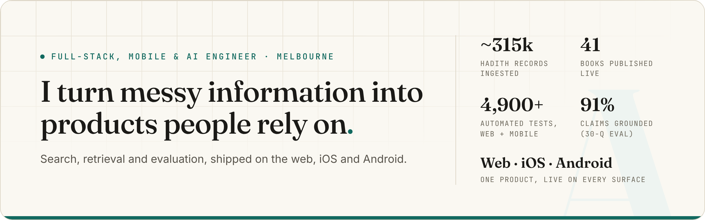

<picture>
  <source media="(prefers-color-scheme: dark)" srcset="assets/banner-dark.png">
  
</picture>

  
  
  

### Hi, I'm Ali

Full-stack, mobile and AI engineer in Melbourne, in the final year of a Bachelor of IT & Commerce at Monash University. I build search and AI systems end to end and measure them: answers that cite their source or abstain, semantic caches checked for wrong hits rather than just hit rate, and offline-first apps that never show a half-downloaded book.

Right now I run [Shia Library](https://shialibrary.com), a search platform over ~315,000 ingested hadith records, live on the web, the App Store and Google Play from one backend I designed, built and operate alone.

## Featured work

<table>
<tr>
<td width="50%" valign="top">

<h3><a href="https://alimuhammadi.com/work/shia-library">Shia Library</a></h3>

Solo · live on web, iOS and Android 
Diacritic-insensitive Arabic, English full-text and semantic search, fused with RRF, plus a cited Ask in beta that grounds 91% of its claims. One Supabase backend serves the web and offline-first React Native apps with native Swift and Kotlin modules.

<a href="https://alimuhammadi.com/work/shia-library">Case study</a> · <a href="https://alimuhammadi.com/work/shia-library-mobile">Mobile case study</a> · <a href="https://shialibrary.com">Live site</a>

Next.js · Supabase · pgvector · Claude · React Native · Swift · Kotlin

</td>
<td width="50%" valign="top">

<h3><a href="https://alimuhammadi.com/work/citation-rag">Citation-Grounded RAG</a></h3>

Solo · public demo 
Hybrid BM25 and embedding retrieval, answered by Claude with native citations, so every sentence links to its exact source span. It abstains when the corpus can't support an answer. Recall@5 0.91 and faithfulness 1.00 (Claude judge) on a 22-question golden set, with the recall gate in CI.

<a href="https://ask.alimuhammadi.com">Live demo</a> · <a href="https://github.com/aliabbas-muhammadi/citation-rag">Code</a> · <a href="https://alimuhammadi.com/work/citation-rag">Case study</a>

Next.js · TypeScript · Claude · OpenAI embeddings

</td>
</tr>
<tr>
<td width="50%" valign="top">

<h3><a href="https://alimuhammadi.com/work/llm-gateway">LLM Gateway (Veritas)</a></h3>

Solo · public playground 
A semantic cache measured on the number the industry skips: the precision of its hits. A two-tier guard lifts cache-hit precision from 0.48 to 1.00 at 0% false positives on a 75-pair adversarial set, and CI fails the build if the false-positive rate rises.

<a href="https://gateway.alimuhammadi.com">Live demo</a> · <a href="https://github.com/aliabbas-muhammadi/veritas">Code</a> · <a href="https://alimuhammadi.com/work/llm-gateway">Case study</a>

Next.js · TypeScript · Claude Haiku · OpenTelemetry

</td>
<td width="50%" valign="top">

<h3><a href="https://alimuhammadi.com/work/judgelab">Judgelab</a></h3>

Solo · open source (MIT) 
How reliable is LLM-as-a-judge? Reproduces GPT-4-vs-human agreement on MT-Bench over 1,814 comparisons and adds what the original left out: Cohen's κ with bootstrap CIs (0.767) and the human–human ceiling (α 0.485). Keyless, and re-derived byte-for-byte in CI.

<a href="https://github.com/aliabbas-muhammadi/judgelab">Code</a> · <a href="https://alimuhammadi.com/work/judgelab">Case study</a>

Python · NumPy · SciPy · pytest

</td>
</tr>
<tr>
<td width="50%" valign="top">

<h3><a href="https://alimuhammadi.com/work/polarity">Polarity</a></h3>

Solo · ML research, source release 
A 184M-parameter DeBERTa-v3 cross-encoder that decides whether two queries can share a cached answer. It recalled 31/31 equivalent pairs with 2/44 false accepts on its target set; weak MRPC transfer (ROC-AUC 0.640) is reported, not hidden.

<a href="https://github.com/aliabbas-muhammadi/polarity">Code</a> · <a href="https://alimuhammadi.com/work/polarity">Case study</a>

Python · PyTorch · Transformers

</td>
<td width="50%" valign="top">

<h3><a href="https://alimuhammadi.com/work/engram">Engram</a></h3>

Solo · in progress 
Bitemporal memory for agents: every fact records when it became true and when it was learned, and conflicts resolve by named, logged rules instead of last-write-wins. 0/6 stale answers against 3/6 for an append-only memory on its benchmark.

<a href="https://github.com/aliabbas-muhammadi/engram">Code</a> · <a href="https://alimuhammadi.com/work/engram">Case study</a>

TypeScript · node:sqlite · SQLite FTS5

</td>
</tr>
</table>

## Try it live

| Project | What you can do | |
| --- | --- | --- |
| [Shia Library](https://alimuhammadi.com/work/shia-library) | Search 41 books of hadith in Arabic or English, with or without diacritics. The iOS and Android apps keep downloaded books readable offline. | [Open](https://shialibrary.com) [App&nbsp;Store](https://alimuhammadi.com/go/shia-library/ios) [Google&nbsp;Play](https://alimuhammadi.com/go/shia-library/android) |
| [Citation-Grounded RAG](https://alimuhammadi.com/work/citation-rag) | Ask about the U.S. Constitution, the Bill of Rights or the Federalist Papers. Every sentence links to the passage it came from, and a question the documents can't answer gets no answer rather than a guess. | [Ask&nbsp;it](https://ask.alimuhammadi.com) |
| [LLM Gateway](https://alimuhammadi.com/work/llm-gateway) | A guided tour of the real gateway: a paraphrase served from cache at $0, a negation blocked by the guard, and a provider outage rescued by failover, with live metrics. | [Try&nbsp;it](https://gateway.alimuhammadi.com) |

## Open-source contributions

<!-- CONTRIBUTIONS:START -->
Merged pull requests across **1 repository** — **2 contributions** and counting.

| Repository | Stars | PRs | Latest |
| --- | --- | --- | --- |
| [**recharts**](https://github.com/recharts/recharts) | ⭐ 27.6k | 2 | [#7653](https://github.com/recharts/recharts/pull/7653) — docs: fix dead UMD install links in README |
<!-- CONTRIBUTIONS:END -->

<!-- INREVIEW:START -->
**In review:** [litellm #37185](https://github.com/BerriAI/litellm/pull/37185) · [litellm #37272](https://github.com/BerriAI/litellm/pull/37272) · [deepeval #3073](https://github.com/confident-ai/deepeval/pull/3073) · [drizzle-orm #6142](https://github.com/drizzle-team/drizzle-orm/pull/6142) · [ethereum-org-website #19090](https://github.com/ethereum/ethereum-org-website/pull/19090)
<!-- INREVIEW:END -->

## Stack

  
  
  
  
  
  
  
  
  
  
  
  
  
  

---

Melbourne, Australia · Full Australian work rights, no sponsorship required · Open to software, mobile, AI and platform engineering internships and graduate roles.
